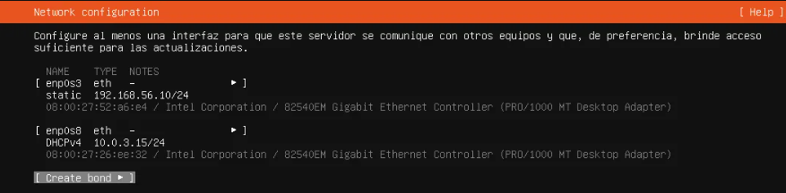
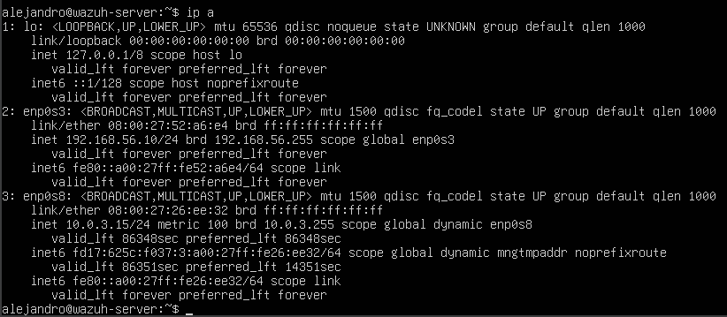
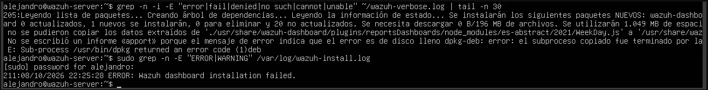
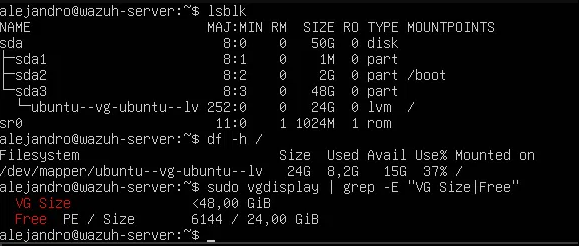
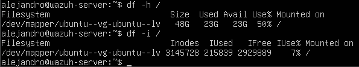

# Home lab de detección con Wazuh: instalación paso a paso

Guía de cómo armé el servidor SIEM de mi laboratorio de ciberseguridad: una VM con **Ubuntu Server 24.04 LTS** y **Wazuh (instalación todo en uno)** sobre VirtualBox. Incluye el problema que tuve durante la instalación, cómo lo diagnostiqué y cómo lo resolví.

---

## 1. Entorno

| Elemento | Detalle |
|---|---|
| Host | PC con Windows, 16 GB de RAM |
| Virtualización | VirtualBox |
| VM del servidor | `wazuh-server` |
| Sistema operativo | Ubuntu Server 24.04.5 LTS (`ubuntu-24.04.5-live-server-amd64.iso`) |
| Software | Wazuh 4.14 (manager, indexer, dashboard y filebeat en una sola máquina) |
| Red del lab | Red interna `lab-seguridad` (192.168.56.0/24) + NAT para internet |

**Por qué Ubuntu 24.04 y no la 26.04:** la 24.04 LTS es la versión que usa la documentación oficial y la mayoría de las guías de Wazuh. En la 26.04 el instalador de Wazuh puede mostrar advertencias de sistema operativo no soportado, así que elegí la opción con menos fricción.

---

## 2. Crear la máquina virtual en VirtualBox

1. **Máquina > Nueva** con estos datos:
   - Nombre: `wazuh-server`
   - Imagen ISO: la de Ubuntu Server 24.04.5
   - Tipo/versión: Linux / Ubuntu (64-bit)
   - **Omitir instalación desatendida** (para ver y controlar cada paso del instalador)
2. **Hardware:**
   - Memoria: 4096 MB al principio (después la subí a **6144 MB**, ver sección 6)
   - Procesadores: 2 a 4 núcleos
3. **Disco:** VDI de **50 GB**, asignación dinámica (sin "Reservar completamente").
4. **Red** (con la VM apagada), en *Configuración > Red*:
   - **Adaptador 1:** Red interna, nombre `lab-seguridad`. Es la red de comunicación entre las máquinas del lab, aislada de mi red real.
   - **Adaptador 2:** NAT. Da salida a internet para actualizar e instalar paquetes.

> Importante: nunca usé modo *bridge*. Así las máquinas "vulnerables" y los ataques de las próximas fases quedan aislados de mi red doméstica.

---

## 3. Instalar Ubuntu Server

Arranqué la VM con el ISO montado y seguí el instalador (que se maneja solo con teclado):

1. **Idioma y teclado:** los que correspondan.
2. **Tipo de instalación:** Ubuntu Server.
3. **Network configuration:** aparecen dos interfaces.
   - `enp0s8` (NAT): quedó con DHCP y tomó la IP `10.0.3.15`. Es la salida a internet.
   - `enp0s3` (red interna): figuraba con *"autoconfiguration failed"*, algo esperado porque esa red no tiene servidor DHCP. La configuré a mano: *Edit IPv4 > Manual* con
     - Subnet: `192.168.56.0/24`
     - Address: `192.168.56.10`
     - Gateway y DNS: vacíos (la salida a internet va por la NAT)
    


4. **Proxy y mirror:** valores por defecto.
5. **Almacenamiento:** "Use an entire disk" con las opciones por defecto (ver el problema que esto causó más adelante).
6. **Profile setup:** nombre del servidor `wazuh-server`, usuario y contraseña (simple y sin caracteres especiales, porque el teclado del instalador puede tener otra distribución).
7. **Ubuntu Pro:** omitido.
8. **SSH:** tildar *Install OpenSSH server*.
9. **Featured snaps:** ninguno.
10. Al terminar, *Reboot now*. Apareció `[FAILED] Failed unmounting /cdrom`, que es normal en VirtualBox: se aprieta Enter y la VM reinicia.

**Verificación:** ya iniciada la sesión, `ip a` mostró `192.168.56.10` en `enp0s3` y `10.0.3.15` en `enp0s8`. `ping -c 3 google.com` respondió con 0% de pérdida.



---

## 4. Preparar el sistema para Wazuh

```bash
sudo apt update && sudo apt upgrade -y
```

Antes de instalar Wazuh tomé una **instantánea** de la VM (*Máquina > Tomar instantánea*, nombre `ubuntu-limpio`) para poder volver atrás rápido si algo salía mal.

---

## 5. Instalar Wazuh (todo en uno)

Descarga del instalador y ejecución:

```bash
curl -o wazuh-install.sh https://packages.wazuh.com/4.14/wazuh-install.sh
sudo bash wazuh-install.sh -a
```

La opción `-a` instala los cuatro componentes en la misma máquina: manager, indexer, dashboard y filebeat. Tarda entre 10 y 15 minutos.

Al finalizar bien, el instalador muestra *"Installation finished"* junto con el usuario `admin` y una **contraseña generada automáticamente**. Si no la copiás en ese momento, se recupera así:

```bash
sudo tar -O -xf wazuh-install-files.tar wazuh-install-files/wazuh-passwords.txt | grep -A1 "indexer_username"
```

(El comando se corre en la carpeta donde se ejecutó el instalador. La contraseña de `admin` es lo que está entre comillas simples en la línea `indexer_password:`.)

> **Seguridad:** la contraseña nunca va en el repositorio ni en capturas públicas. Se guarda aparte.

---

## 6. El problema: la instalación fallaba y se deshacía sola

### Síntomas

Al terminar la primera instalación, la verificación de servicios mostró todo caído:

```bash
sudo systemctl is-active wazuh-manager wazuh-indexer wazuh-dashboard filebeat
# failed / inactive / inactive / active
```

Al revisar el log (`/var/log/wazuh-install.log`) se vio que el instalador había fallado y se **revertió por su cuenta**: aparecía *"Installation cleaned"* y se habían desinstalado el indexer, filebeat y el dashboard.

### Diagnóstico, paso a paso

**1. Primer indicio:** el único error marcado era `ERROR: Wazuh dashboard installation failed`. El `failed` del manager era una consecuencia de la limpieza automática, no la causa.



**2. Descartar hipótesis:**
- *Falta de RAM:* `sudo dmesg | grep -i -E "out of memory|killed process"` no devolvió nada, o sea el sistema no mató procesos.
- *Descarga cortada:* el log mostraba que el paquete del dashboard (196 MB) se había descargado completo.
- *Disco:* `df -h /` mostraba 14 GB libres. Pero esa medición se hizo **después** de que el instalador borrara todo, así que no reflejaba el estado durante la instalación.

**3. El error real, en dos pasos:** el log indicaba que el script de post-instalación del paquete `wazuh-dashboard` terminó con código de salida 1, pero no decía por qué. Por eso volví a instalar guardando toda la salida:

```bash
sudo bash wazuh-install.sh -a -v 2>&1 | tee ~/wazuh-verbose.log
```

El modo `-v` (verbose) más `tee` dejó registrado el error. Se buscó con:

```bash
grep -n -i -E "error|fail|denied|no such|cannot|unable" ~/wazuh-verbose.log | tail -n 30
```

El resultado mostró que `dpkg` no pudo copiar archivos del dashboard y que el mensaje de error indicaba **disco lleno**.

### Obstáculo intermedio: paquete a medio instalar

Entre el primer y el segundo intento apareció otro problema. Tras la limpieza fallida, `wazuh-manager` seguía figurando como instalado (`ii` en `dpkg -l`) pero sin sus archivos. Al intentar eliminarlo:

```
dpkg: error al procesar el paquete wazuh-manager (--remove):
 script pre-removal devolvió el código de salida de error 127
```

El código 127 significa "comando no encontrado": el script intentaba ejecutar `/var/ossec/bin/wazuh-control`, que la limpieza automática ya había borrado. Solución: apartar el script que fallaba y repetir la eliminación.

```bash
sudo mkdir -p /root/dpkg-backup
sudo mv /var/lib/dpkg/info/wazuh-manager.prerm /root/dpkg-backup/
sudo mv /var/lib/dpkg/info/wazuh-manager.postrm /root/dpkg-backup/
sudo apt-get remove --purge wazuh-manager -y
```

Verificación de que quedó limpio (los dos primeros sin salida y el tercero con *No such file or directory*):

```bash
dpkg -l | grep -i wazuh
sudo dpkg --audit
ls /var/ossec
```

### Causa raíz

Lo que reveló `lsblk` y `vgdisplay`:



```
sda      50G  disk
└─sda3   48G  part
  └─ubuntu--vg-ubuntu--lv   24G  lvm  /
VG Size  48,00 GiB
Free     24,00 GiB
```

El disco virtual era de 50 GB, pero el instalador guiado de Ubuntu Server **solo asignó 24 GB al volumen raíz** y dejó otros 24 GB libres sin usar dentro del grupo de volúmenes. Wazuh instala cuatro componentes grandes (el solo desempaquetado del dashboard ocupa más de 1 GB, y el indexer más de 1 GB), y durante la instalación el volumen de 24 GB se llenó.

### Solución

**1. Extender el volumen lógico** para usar todo el espacio libre (la opción `-r` agranda también el sistema de archivos):

```bash
sudo lvextend -r -l +100%FREE /dev/ubuntu-vg/ubuntu-lv
df -h /
```

El `df` pasó a mostrar unos 48 GB.



**2. Limpiar restos y comprobar que no quedaran paquetes a medias:**

```bash
sudo apt-get clean
dpkg -l | grep -i wazuh
sudo dpkg --audit
```

**3. Reintentar la instalación:**

```bash
sudo bash wazuh-install.sh -a -v 2>&1 | tee ~/wazuh-verbose.log
```

Esta vez terminó con *"Installation finished"*.

### Aclaración sobre qué se cambió

Antes del intento exitoso apliqué dos cambios a la vez: subí la RAM de la VM de 4 GB a 6 GB y extendí el volumen. El log apuntaba a disco lleno, por eso considero que la ampliación del volumen fue la corrección clave, pero como ambos cambios se hicieron juntos no puedo aislar con certeza el efecto de cada uno.

Al final de la instalación apareció en consola un aviso del kernel (`e1000 ... NETDEV WATCHDOG ... Reset adapter` en `enp0s8`). Es un comportamiento conocido del adaptador de red virtual de VirtualBox con NAT: la tarjeta se reinicia sola un instante y no afecta al funcionamiento.

---

## 7. Errores comunes que tuve en el camino

| Problema | Causa | Solución |
|---|---|---|
| Descargué *Ubuntu Desktop* en vez de *Server* | Elegí el enlace equivocado en la página de descargas | Bajar la imagen **live-server** (el nombre del archivo debe contener `live-server`) |
| Archivo `.torrent` en lugar del ISO | Elegí la pestaña BitTorrent | Usar la descarga directa o la pestaña *Lanzamientos anteriores* |
| VirtualBox marcaba error en *Instalación desatendida* | Campos de contraseña vacíos | Marcar *Omitir instalación desatendida* para usar el instalador manual |
| `wazuh-install.sh: No such file or directory` | `curl` imprimió el script en pantalla en vez de guardarlo (se usó `-0` con cero en lugar de `-O`) | Usar `curl -o wazuh-install.sh <URL>` (o minúscula explícita) y verificar con `ls -la` |
| `grep` no devolvía la contraseña | Faltaba un espacio en el patrón de búsqueda | Buscar solo `indexer_username` |

---

## 8. Estado actual y próximos pasos

**Hecho:**
- VM `wazuh-server` con red interna y NAT configuradas
- Ubuntu Server 24.04.5 instalado, con IP fija 192.168.56.10
- Wazuh instalado correctamente (mensaje *Installation finished*)

**Pendiente:**
1. Verificar los servicios con `systemctl is-active wazuh-manager wazuh-indexer wazuh-dashboard filebeat` (deben salir cuatro `active`).
2. Agregar reglas de reenvío de puertos en el adaptador NAT para acceder desde el host:
   - `127.0.0.1:8443` → `10.0.3.15:443` (dashboard)
   - `127.0.0.1:2222` → `10.0.3.15:22` (SSH, para poder copiar y pegar comandos)
3. Entrar al dashboard en `https://127.0.0.1:8443` (el certificado es autofirmado, hay que aceptar la advertencia).
4. Crear la VM de Windows y conectarle el agente de Wazuh.
5. Simular ataques desde Kali y documentar qué alertas genera cada uno.

---

## 9. Lecciones aprendidas

- **Medir en el momento del error, no después.** El `df` que mostraba espacio libre se había tomado tras la limpieza automática y llevó a descartar la causa real durante un buen rato.
- **Registrar toda la salida de comandos largos** (`-v` y `tee`). Cuando un instalador se deshace solo, el mensaje que explica el fallo puede no estar en el log principal.
- **El instalador guiado de Ubuntu no siempre usa todo el disco.** Conviene revisar con `lsblk` y `vgdisplay` y extender el volumen antes de instalar software pesado.
- **Los códigos de salida dicen mucho:** el 127 señalaba un archivo faltante, no un fallo del servicio.
- **Un snapshot antes de instalar** ahorra tiempo cuando algo sale mal.
