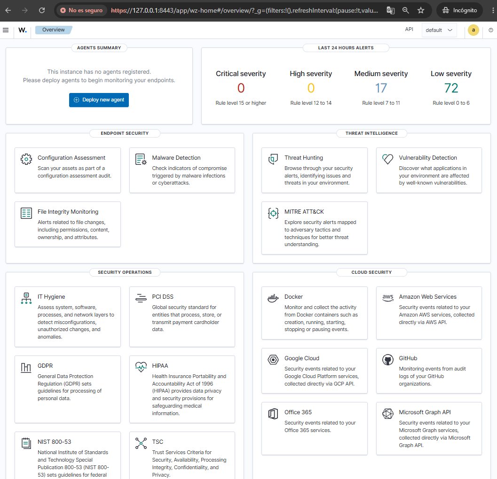
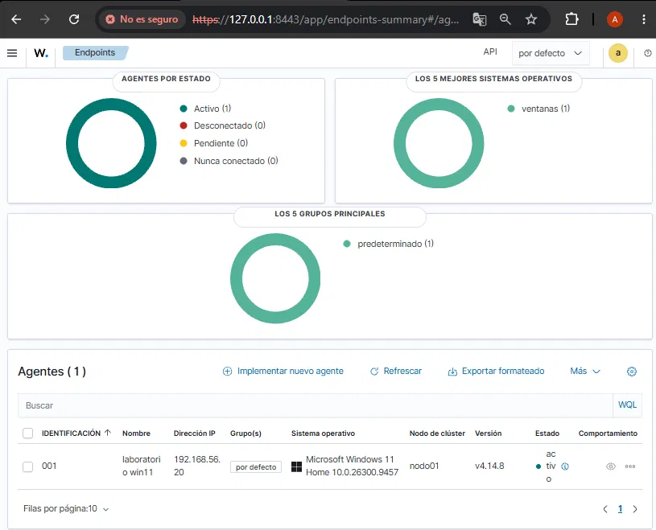
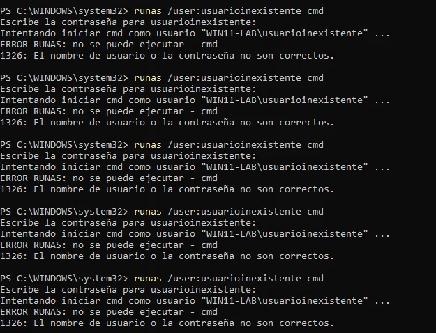
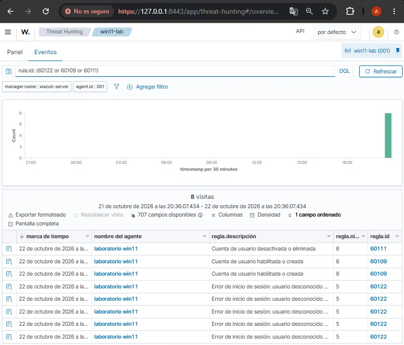
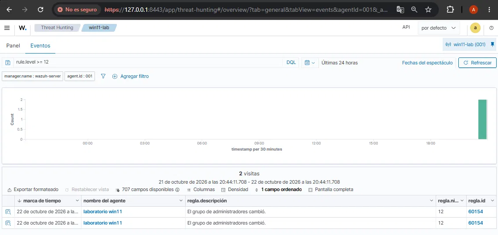
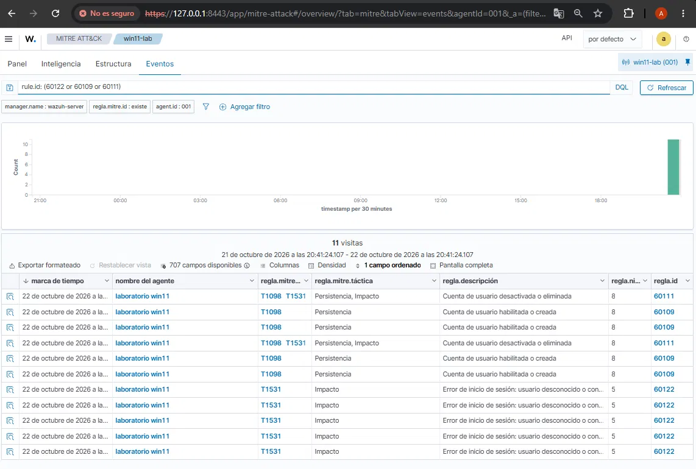
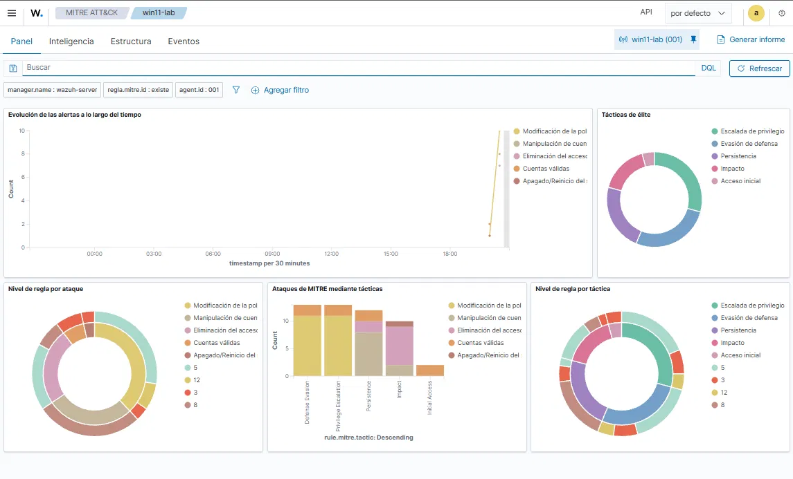

# Home lab de detección con Wazuh: instalación paso a paso

Guía de cómo armé el servidor SIEM de mi laboratorio de ciberseguridad: una VM con **Ubuntu Server 24.04 LTS** y **Wazuh (instalación todo en uno)** sobre VirtualBox. Incluye el problema que tuve durante la instalación, cómo lo diagnostiqué y cómo lo resolví.

---

## 1. Entorno

| Elemento | Detalle |
|---|---|
| Host | PC con Windows, 16 GB de RAM |
| Virtualización | VirtualBox |
| VM del servidor | `wazuh-server` |
| Sistema operativo | Ubuntu Server 24.04.5 LTS (`ubuntu-24.04.5-live-server-amd64.iso`) |
| Software | Wazuh 4.14 (manager, indexer, dashboard y filebeat en una sola máquina) |
| Red del lab | Red interna `lab-seguridad` (192.168.56.0/24) + NAT para internet |

**Por qué Ubuntu 24.04 y no la 26.04:** la 24.04 LTS es la versión que usa la documentación oficial y la mayoría de las guías de Wazuh. En la 26.04 el instalador de Wazuh puede mostrar advertencias de sistema operativo no soportado, así que elegí la opción con menos fricción.

---

## 2. Crear la máquina virtual en VirtualBox

1. **Máquina > Nueva** con estos datos:
   - Nombre: `wazuh-server`
   - Imagen ISO: la de Ubuntu Server 24.04.5
   - Tipo/versión: Linux / Ubuntu (64-bit)
   - **Omitir instalación desatendida** (para ver y controlar cada paso del instalador)
2. **Hardware:**
   - Memoria: 4096 MB al principio (después la subí a **6144 MB**, ver sección 6)
   - Procesadores: 2 a 4 núcleos
3. **Disco:** VDI de **50 GB**, asignación dinámica (sin "Reservar completamente").
4. **Red** (con la VM apagada), en *Configuración > Red*:
   - **Adaptador 1:** Red interna, nombre `lab-seguridad`. Es la red de comunicación entre las máquinas del lab, aislada de mi red real.
   - **Adaptador 2:** NAT. Da salida a internet para actualizar e instalar paquetes.

> Importante: nunca usé modo *bridge*. Así las máquinas "vulnerables" y los ataques de las próximas fases quedan aislados de mi red doméstica.

---

## 3. Instalar Ubuntu Server

Arranqué la VM con el ISO montado y seguí el instalador (que se maneja solo con teclado):

1. **Idioma y teclado:** los que correspondan.
2. **Tipo de instalación:** Ubuntu Server.
3. **Network configuration:** aparecen dos interfaces.
   - `enp0s8` (NAT): quedó con DHCP y tomó la IP `10.0.3.15`. Es la salida a internet.
   - `enp0s3` (red interna): figuraba con *"autoconfiguration failed"*, algo esperado porque esa red no tiene servidor DHCP. La configuré a mano: *Edit IPv4 > Manual* con
     - Subnet: `192.168.56.0/24`
     - Address: `192.168.56.10`
     - Gateway y DNS: vacíos (la salida a internet va por la NAT)
    


4. **Proxy y mirror:** valores por defecto.
5. **Almacenamiento:** "Use an entire disk" con las opciones por defecto (ver el problema que esto causó más adelante).
6. **Profile setup:** nombre del servidor `wazuh-server`, usuario y contraseña (simple y sin caracteres especiales, porque el teclado del instalador puede tener otra distribución).
7. **Ubuntu Pro:** omitido.
8. **SSH:** tildar *Install OpenSSH server*.
9. **Featured snaps:** ninguno.
10. Al terminar, *Reboot now*. Apareció `[FAILED] Failed unmounting /cdrom`, que es normal en VirtualBox: se aprieta Enter y la VM reinicia.

**Verificación:** ya iniciada la sesión, `ip a` mostró `192.168.56.10` en `enp0s3` y `10.0.3.15` en `enp0s8`. `ping -c 3 google.com` respondió con 0% de pérdida.


---

## 4. Preparar el sistema para Wazuh

```bash
sudo apt update && sudo apt upgrade -y
```

Antes de instalar Wazuh tomé una **instantánea** de la VM (*Máquina > Tomar instantánea*, nombre `ubuntu-limpio`) para poder volver atrás rápido si algo salía mal.

---

## 5. Instalar Wazuh (todo en uno)

Descarga del instalador y ejecución:

```bash
curl -o wazuh-install.sh https://packages.wazuh.com/4.14/wazuh-install.sh
sudo bash wazuh-install.sh -a
```

La opción `-a` instala los cuatro componentes en la misma máquina: manager, indexer, dashboard y filebeat. Tarda entre 10 y 15 minutos.

Al finalizar bien, el instalador muestra *"Installation finished"* junto con el usuario `admin` y una **contraseña generada automáticamente**. Si no la copiás en ese momento, se recupera así:

```bash
sudo tar -O -xf wazuh-install-files.tar wazuh-install-files/wazuh-passwords.txt | grep -A1 "indexer_username"
```

(El comando se corre en la carpeta donde se ejecutó el instalador. La contraseña de `admin` es lo que está entre comillas simples en la línea `indexer_password:`.)

> **Seguridad:** la contraseña nunca va en el repositorio ni en capturas públicas. Se guarda aparte.

---

## 6. El problema: la instalación fallaba y se deshacía sola

### Síntomas

Al terminar la primera instalación, la verificación de servicios mostró todo caído:

```bash
sudo systemctl is-active wazuh-manager wazuh-indexer wazuh-dashboard filebeat
# failed / inactive / inactive / active
```

Al revisar el log (`/var/log/wazuh-install.log`) se vio que el instalador había fallado y se **revertió por su cuenta**: aparecía *"Installation cleaned"* y se habían desinstalado el indexer, filebeat y el dashboard.

### Diagnóstico, paso a paso

**1. Primer indicio:** el único error marcado era `ERROR: Wazuh dashboard installation failed`. El `failed` del manager era una consecuencia de la limpieza automática, no la causa.


**2. Descartar hipótesis:**
- *Falta de RAM:* `sudo dmesg | grep -i -E "out of memory|killed process"` no devolvió nada, o sea el sistema no mató procesos.
- *Descarga cortada:* el log mostraba que el paquete del dashboard (196 MB) se había descargado completo.
- *Disco:* `df -h /` mostraba 14 GB libres. Pero esa medición se hizo **después** de que el instalador borrara todo, así que no reflejaba el estado durante la instalación.

**3. El error real, en dos pasos:** el log indicaba que el script de post-instalación del paquete `wazuh-dashboard` terminó con código de salida 1, pero no decía por qué. Por eso volví a instalar guardando toda la salida:

```bash
sudo bash wazuh-install.sh -a -v 2>&1 | tee ~/wazuh-verbose.log
```

El modo `-v` (verbose) más `tee` dejó registrado el error. Se buscó con:

```bash
grep -n -i -E "error|fail|denied|no such|cannot|unable" ~/wazuh-verbose.log | tail -n 30
```

El resultado mostró que `dpkg` no pudo copiar archivos del dashboard y que el mensaje de error indicaba **disco lleno**.

### Obstáculo intermedio: paquete a medio instalar

Entre el primer y el segundo intento apareció otro problema. Tras la limpieza fallida, `wazuh-manager` seguía figurando como instalado (`ii` en `dpkg -l`) pero sin sus archivos. Al intentar eliminarlo:

```
dpkg: error al procesar el paquete wazuh-manager (--remove):
 script pre-removal devolvió el código de salida de error 127
```

El código 127 significa "comando no encontrado": el script intentaba ejecutar `/var/ossec/bin/wazuh-control`, que la limpieza automática ya había borrado. Solución: apartar el script que fallaba y repetir la eliminación.

```bash
sudo mkdir -p /root/dpkg-backup
sudo mv /var/lib/dpkg/info/wazuh-manager.prerm /root/dpkg-backup/
sudo mv /var/lib/dpkg/info/wazuh-manager.postrm /root/dpkg-backup/
sudo apt-get remove --purge wazuh-manager -y
```

Verificación de que quedó limpio (los dos primeros sin salida y el tercero con *No such file or directory*):

```bash
dpkg -l | grep -i wazuh
sudo dpkg --audit
ls /var/ossec
```

### Causa raíz

Lo que reveló `lsblk` y `vgdisplay`:


```
sda      50G  disk
└─sda3   48G  part
  └─ubuntu--vg-ubuntu--lv   24G  lvm  /
VG Size  48,00 GiB
Free     24,00 GiB
```

El disco virtual era de 50 GB, pero el instalador guiado de Ubuntu Server **solo asignó 24 GB al volumen raíz** y dejó otros 24 GB libres sin usar dentro del grupo de volúmenes. Wazuh instala cuatro componentes grandes (el solo desempaquetado del dashboard ocupa más de 1 GB, y el indexer más de 1 GB), y durante la instalación el volumen de 24 GB se llenó.

### Solución

**1. Extender el volumen lógico** para usar todo el espacio libre (la opción `-r` agranda también el sistema de archivos):

```bash
sudo lvextend -r -l +100%FREE /dev/ubuntu-vg/ubuntu-lv
df -h /
```

El `df` pasó a mostrar unos 48 GB.


**2. Limpiar restos y comprobar que no quedaran paquetes a medias:**

```bash
sudo apt-get clean
dpkg -l | grep -i wazuh
sudo dpkg --audit
```

**3. Reintentar la instalación:**

```bash
sudo bash wazuh-install.sh -a -v 2>&1 | tee ~/wazuh-verbose.log
```

Esta vez terminó con *"Installation finished"*.

### Aclaración sobre qué se cambió

Antes del intento exitoso apliqué dos cambios a la vez: subí la RAM de la VM de 4 GB a 6 GB y extendí el volumen. El log apuntaba a disco lleno, por eso considero que la ampliación del volumen fue la corrección clave, pero como ambos cambios se hicieron juntos no puedo aislar con certeza el efecto de cada uno.

Al final de la instalación apareció en consola un aviso del kernel (`e1000 ... NETDEV WATCHDOG ... Reset adapter` en `enp0s8`). Es un comportamiento conocido del adaptador de red virtual de VirtualBox con NAT: la tarjeta se reinicia sola un instante y no afecta al funcionamiento.

---

## 7. Errores comunes que tuve en el camino

| Problema | Causa | Solución |
|---|---|---|
| Descargué *Ubuntu Desktop* en vez de *Server* | Elegí el enlace equivocado en la página de descargas | Bajar la imagen **live-server** (el nombre del archivo debe contener `live-server`) |
| Archivo `.torrent` en lugar del ISO | Elegí la pestaña BitTorrent | Usar la descarga directa o la pestaña *Lanzamientos anteriores* |
| VirtualBox marcaba error en *Instalación desatendida* | Campos de contraseña vacíos | Marcar *Omitir instalación desatendida* para usar el instalador manual |
| `wazuh-install.sh: No such file or directory` | `curl` imprimió el script en pantalla en vez de guardarlo (se usó `-0` con cero en lugar de `-O`) | Usar `curl -o wazuh-install.sh <URL>` (o minúscula explícita) y verificar con `ls -la` |
| `grep` no devolvía la contraseña | Faltaba un espacio en el patrón de búsqueda | Buscar solo `indexer_username` |
| "Wazuh dashboard server is not ready yet" | El dashboard todavía está arrancando o espera al indexer | Esperar uno o dos minutos y verificar que los cuatro servicios estén `active` |
| El cambio de contraseña falla con "must have a length between 8 and 64..." | La clave no incluía un símbolo permitido (`.` `*` `+` `?` `-`) | Usar una clave con alguno de esos símbolos |
| El dashboard devuelve error 500 o `Authentication Exception` tras cambiar la clave | Se cargó la clave de `admin` donde el dashboard espera la de `kibanaserver`, o hay una sesión vieja en el navegador | Restaurar la clave de `kibanaserver` en el keystore y probar en ventana de incógnito |

---

## 8. Acceder al dashboard y cambiar la contraseña de `admin`

### Acceso desde mi PC

La VM usa una red interna aislada, así que mi PC real no la ve directamente. Para abrir el dashboard en el navegador usé un **reenvío de puertos** en el adaptador NAT de VirtualBox (*Configuración > Red > Adaptador 2 > Avanzadas > Reenvío de puertos*):

| Protocolo | IP anfitrión | Puerto anfitrión | IP invitado | Puerto invitado |
|---|---|---|---|---|
| TCP | 127.0.0.1 | 8443 | 10.0.3.15 | 443 |

Con eso el panel queda en `https://127.0.0.1:8443`. El certificado es autofirmado, así que el navegador muestra una advertencia que hay que aceptar (normal en un lab).

Antes de entrar verifiqué que los cuatro servicios corrían:

```bash
sudo systemctl is-active wazuh-manager wazuh-indexer wazuh-dashboard filebeat
```

Justo después de encender la VM, el indexer aparece como `activating` durante uno o dos minutos (es el componente más pesado). Hay que esperar a que pase a `active`; mientras tanto el dashboard puede mostrar *"Wazuh dashboard server is not ready yet"*.



Todavía no hay agentes registrados, así que el panel está vacío. Es lo esperado en este punto.

### Cambiar la contraseña de `admin`

La contraseña que genera el instalador es larga y difícil de recordar, así que la cambié con la herramienta oficial de Wazuh:

```bash
curl -o wazuh-passwords-tool.sh https://packages.wazuh.com/4.14/wazuh-passwords-tool.sh
sudo bash wazuh-passwords-tool.sh -u admin -p 'NuevaClave'
```

**Primer problema: la clave no cumplía los requisitos.** La herramienta devolvió:

```
ERROR: The password must have a length between 8 and 64 characters and contain
at least one upper and lower case letter, a number and a symbol(.*+?-).
```

Los símbolos aceptados son solo `.` `*` `+` `?` `-`. Cualquier otro (`!`, `@`, `_`) no cuenta. No cambió nada: la clave anterior siguió funcionando. Con una clave que cumplía las reglas, el cambio se aplicó. Lo verifiqué contra el indexer:

```bash
curl -k -u admin:'NuevaClave' https://localhost:9200
```

La respuesta incluyó `cluster_name`, así que el indexer aceptaba la clave nueva.

### El dashboard dejó de funcionar y cómo lo resolví

Después del cambio, el dashboard respondió con:

```
{"statusCode":500,"error":"Error interno del servidor", ...}
```

Mi hipótesis fue que el dashboard seguía usando la clave vieja, y cargué la clave nueva de `admin` en su keystore. **Eso fue un error mío.** El dashboard no se conecta al indexer con `admin` sino con el usuario interno **`kibanaserver`**, que tiene su propia contraseña. Al reemplazarla por la de `admin`, el dashboard empezó a fallar con un `Response Error` repetido cada pocos segundos en su log:

```bash
sudo journalctl -u wazuh-dashboard --no-pager | tail -n 20
```

No pude confirmar con certeza el origen del primer error 500, porque el log solo mostraba un mensaje genérico. Lo que sí quedó claro es la configuración correcta:

| Componente | Usuario con el que se conecta al indexer | Qué hay que actualizar al cambiar la clave de `admin` |
|---|---|---|
| Dashboard | `kibanaserver` | Nada. Hay que dejar su contraseña original en el keystore |
| Filebeat | `admin` | Sí: `echo 'NuevaClave' \| sudo filebeat keystore add password --stdin --force` |

Para devolverle al dashboard la contraseña de `kibanaserver`, que el instalador dejó en `wazuh-install-files.tar`, la leí a una variable sin mostrarla en pantalla, comprobé que funcionaba y actualicé el keystore:

```bash
KP=$(sudo tar -O -xf wazuh-install-files.tar wazuh-install-files/wazuh-passwords.txt \
  | grep -A1 "indexer_username: 'kibanaserver'" | grep indexer_password | cut -d"'" -f2)
curl -k -u kibanaserver:"$KP" https://localhost:9200
echo "$KP" | sudo /usr/share/wazuh-dashboard/bin/opensearch-dashboards-keystore --allow-root add -f --stdin opensearch.password
unset KP
sudo systemctl restart wazuh-dashboard
```

Después del reinicio apareció otro error en el log, `Authentication Exception`. Esta vez era una **sesión vieja guardada en el navegador**, de antes del cambio de contraseña. En una ventana de incógnito pude iniciar sesión con `admin` y la clave nueva sin problemas. Borrar las cookies de `127.0.0.1` lo resuelve en el navegador habitual.

> **Seguridad:** las contraseñas no van en capturas ni en el repositorio. Al compartir comandos en capturas conviene reemplazar la clave por un texto como `NuevaClave`.

---

## 9. Conectar el agente de Windows

### La VM `win11-lab`

| Elemento | Detalle |
|---|---|
| Sistema | Windows 11 Home x64 (ISO oficial de Microsoft, español) |
| Recursos | 4 GB de RAM, 2 núcleos, disco de 64 GB (asignación dinámica) |
| Red | Adaptador 1: red interna `lab-seguridad` con IP fija `192.168.56.20`. Adaptador 2: NAT para descargar el agente |
| Instalación | Instalación desatendida de VirtualBox (resuelve solos los requisitos de TPM y Secure Boot) |

Dos tropiezos antes de arrancar:

- **Descargué por error la ISO para Arm64.** La página de Microsoft decía *"Windows 11 para PC basados en Arm"*. Mi PC es Intel/AMD, así que hay que bajar la imagen **x64** (tercera opción de la página de descarga). Una ISO de otra arquitectura no arranca en VirtualBox.
- **La VM falló al iniciar** con *"no se hallaron un sistema operativo o un orden de arranque mal configurado"*. El ISO no estaba montado en la unidad óptica. Se resolvió montándolo y apretando una tecla cuando aparece *"Press any key to boot from CD or DVD"*.

VirtualBox solo ofreció la edición **Home**. Alcanza para el lab, con una limitación a tener en cuenta: Windows 11 Home no acepta conexiones de Escritorio Remoto entrantes, así que no sirve para simular ataques contra RDP.

### Verificar la conexión con el servidor

Tras fijar la IP en el adaptador de la red interna, comprobé que la VM llega al servidor Wazuh, incluido el puerto de registro de agentes (1515):

```powershell
ping 192.168.56.10
Test-NetConnection 192.168.56.10 -Port 1515
```

El `ping` respondió sin pérdidas y `TcpTestSucceeded` dio `True`.

### Instalar el agente

Abrí el dashboard desde un navegador **dentro de la VM de Windows** (`https://192.168.56.10`), fui a *Agents > Deploy new agent*, elegí Windows e indiqué `192.168.56.10` como dirección del servidor y `win11-lab` como nombre. El asistente genera un comando de PowerShell que descarga el instalador y lo instala:

```powershell
Invoke-WebRequest -Uri https://packages.wazuh.com/4.x/windows/wazuh-agent-4.14.8-1.msi -OutFile $env:tmp\wazuh-agent
msiexec.exe /i $env:tmp\wazuh-agent /q WAZUH_MANAGER='192.168.56.10' WAZUH_AGENT_NAME='win11-lab'
NET START Wazuh
```

**Detalle:** el agente apareció en el dashboard como **Pendiente** y recién pasó a **Activo** cuando inicié el servicio con `NET START Wazuh`. "Pendiente" significa que el servidor ya conoce al agente pero todavía no recibió su primera conexión.



---

## 10. Primera detección: actividad de prueba en Windows



Para validar que el SIEM detecta actividad, generé eventos en mi propia VM con una PowerShell como administrador:

```powershell
# 1) Inicios de sesión fallidos (repetido 5 veces)
runas /user:usuarioinexistente cmd

# 2) Crear un usuario, agregarlo al grupo de administradores y borrarlo
net user labtest ClaveDePrueba-1 /add
net localgroup Administradores labtest /add
net user labtest /delete
```

En un Windows en español el grupo se llama **Administradores**. Con el nombre en inglés (`administrators`) el comando falla con el error de sistema 1376 (*"El grupo local especificado no existe"*), y no se genera el evento que se busca.

### Qué detectó Wazuh

En *Threat Hunting > Eventos*, filtrando por el agente `win11-lab`:

| Regla | Descripción | Nivel | Eventos |
|---|---|---|---|
| 60122 | Error de inicio de sesión: usuario desconocido o contraseña incorrecta | 5 | 5 (uno por cada intento) |
| 60109 | Cuenta de usuario habilitada o creada | 8 | 4 |
| 60111 | Cuenta de usuario desactivada o eliminada | 8 | 2 |
| 60154 | El grupo de administradores cambió | **12** | 2 |

Repetí la prueba de crear y borrar la cuenta, por eso algunas reglas aparecen duplicadas. Cada usuario nuevo también generó alertas de cambio de grupo de nivel 5 (reglas 60160 y 60170), probablemente porque Windows agrega las cuentas nuevas a un grupo por defecto.





### Relación con MITRE ATT&CK

La vista *MITRE ATT&CK* del dashboard asocia estas reglas con técnicas del framework:

| Regla | Técnica | Táctica |
|---|---|---|
| 60122 (inicio de sesión fallido) | T1531 | Impacto |
| 60109 (cuenta creada) | T1098 | Persistencia |
| 60111 (cuenta eliminada) | T1098 y T1531 | Persistencia e Impacto |





### Lo que observé

- **Wazuh prioriza los cambios de privilegios.** Cinco inicios de sesión fallidos quedan en nivel 5, y la cuenta nueva sube a 8, pero **la única alerta de nivel 12 es el cambio en el grupo de administradores**.
- **Cinco intentos fallidos no disparan alertas de correlación.** Las reglas que agrupan muchos fallos en poco tiempo necesitan más intentos; queda como prueba pendiente.
- **Las asociaciones MITRE son las que trae cada regla y hay que interpretarlas con criterio.** Wazuh vincula los inicios de sesión fallidos con T1531 (*Account Access Removal*), mientras que para intentos repetidos de adivinar una contraseña lo habitual es pensar en *Brute Force* (T1110).
- **No todo el ruido es mío.** Del total de eventos del agente, una parte es actividad normal de Windows y de la evaluación de configuración (CIS) que corre al conectarse, y se filtra por regla para aislar la prueba.

### Alcance y límites

Es actividad administrativa legítima generada a propósito en mi propia VM, no un ataque real. Lo que valida es la cadena completa (agente, servidor, alerta, vista MITRE) y no la capacidad de detectar a un adversario. El lab tiene un único endpoint Windows.

---

## 11. Estado actual y próximos pasos

**Hecho:**
- VM `wazuh-server` con red interna y NAT configuradas
- Ubuntu Server 24.04.5 instalado, con IP fija 192.168.56.10
- Wazuh instalado correctamente y los cuatro servicios en `active`
- Dashboard accesible desde mi PC por reenvío de puertos y contraseña de `admin` cambiada
- VM `win11-lab` conectada a la red interna, con el agente de Wazuh en estado Activo
- Primera detección: inicios de sesión fallidos, creación y eliminación de cuenta, y cambio en el grupo de administradores, con su correlación en MITRE ATT&CK

**Pendiente:**
1. Sumar la VM de Kali y simular escaneos y ataques de fuerza bruta contra `win11-lab`. Con 16 GB de RAM no alcanzan las tres VM a la vez, así que tengo que resolver cómo repartir el lab.
2. Probar más intentos de inicio de sesión fallidos para ver si se dispara una regla de correlación.
3. Documentar cada ataque con su detección en Wazuh y su técnica MITRE.

---

## 12. Lecciones aprendidas

- **Medir en el momento del error, no después.** El `df` que mostraba espacio libre se había tomado tras la limpieza automática del instalador y llevó a descartar la causa real durante un buen rato.
- **Registrar toda la salida de comandos largos** (`-v` y `tee`). Cuando un instalador se deshace solo, el mensaje que explica el fallo puede no estar en el log principal.
- **El instalador guiado de Ubuntu no siempre usa todo el disco.** Conviene revisar con `lsblk` y `vgdisplay` y extender el volumen antes de instalar software pesado.
- **Los códigos de salida dicen mucho:** el 127 señalaba un archivo faltante, no un fallo del servicio.
- **Un snapshot antes de cada cambio grande** ahorra tiempo cuando algo sale mal.
- **Cada componente usa su propio usuario.** El dashboard se conecta como `kibanaserver` y filebeat como `admin`. Cambiar la clave de uno no obliga a cambiar la del otro, y mezclarlas rompe el panel.
- **Leer el mensaje de error completo antes de reintentar:** la herramienta de contraseñas decía exactamente qué símbolos aceptaba.
- **Después de cambiar una contraseña, probar en una ventana de incógnito.** Una sesión vieja en el navegador puede dar errores de autenticación que parecen un problema del servidor.
- **La ISO tiene que coincidir con la arquitectura del equipo.** Una imagen Arm64 no arranca en una PC Intel o AMD.
- **Verificar que cada comando de la prueba terminó bien antes de interpretar las alertas.** El comando con el nombre de grupo en inglés falló con el error 1376, y los eventos de grupo de esa primera ronda venían de otra cosa.
- **Los nombres de los grupos de Windows dependen del idioma del sistema.**
- **Las técnicas MITRE que muestra Wazuh son una guía, no un veredicto:** conviene contrastarlas con lo que realmente se hizo.

